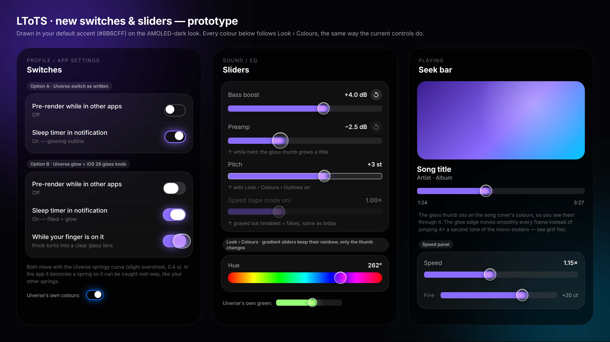

# Grill: controls rework + micro-stutters

Status: **4 of 25 answered** (Q1, Q8, Q16, Q24) · started 2026-11-28

This is the question sheet for the visual rework of LToTS's switches, sliders and buttons, and for the micro-stutter pass. Every question has my recommended answer. Write yours under **Answer:** (or just say "rec" to take mine). Nothing in the app is changed until the questions are answered.

Prototype picture: [`controls-prototype.png`](controls-prototype.png) (source: [`controls-prototype.html`](controls-prototype.html))



---

## The request, in short

1. **Switches/buttons** should look and feel like the Uiverse switch `gharsh11032000/brave-pug-20` (outlined pill, white knob, springy overshoot, glowing border when on), mixed with the current generation of Apple buttons (iOS 26 Liquid Glass).
2. **Sliders** should look like the Uiverse range `javierBarroso/blue-lion-57` (thick bar, bright level with a soft glowing front edge), **without the volume icon**, with a **transparent button (thumb) on top**. Every slider setting already in the app stays; only the look changes.
3. **Feel / micro-stutters**: make the app feel smoother.

Credits that go at the top of the new code:

```
// From Uiverse.io by gharsh11032000 - https://uiverse.io/gharsh11032000/brave-pug-20
// MIT License, Copyright (c) gharsh11032000 (Harsh Gupta)
// From Uiverse.io by javierBarroso - https://uiverse.io/javierBarroso/blue-lion-57
// MIT License, Copyright (c) seyed-mohsen-mousavi (SEYED), javierBarroso (Javier Barroso)
```

## Split: this is two requests, not one

| | Request 1: switches + sliders (look) | Request 2: button feel + micro-stutters |
|---|---|---|
| Files | `ui/components/Components.kt` (`LSwitch`, `LSlider`, `LabeledSlider`), `screens/LookScreen.kt` (`GradientSlider`), `screens/NowPlayingScreen.kt` (seek bar, speed/pitch) | `ui/Navigation.kt` (`pressScale`, `Springs`), `ui/glass/Glass.kt` (`GlassCircleButton`), `Pill`, `SegmentedToggle`, icon buttons, `ui/PlayerUi.kt`, build setup |
| Why separate | Mostly two shared components: one change reaches the app's 42 switch rows and about 30 sliders. Easy to check against the picture. | Touches many screens and needs measuring on your Xiaomi before and after. Mixing it with the restyle would make it hard to tell which change caused what. |
| Size | Small/medium | Medium/large |

**Q0. OK to do it in this order: Request 1 first, then Request 2 in a new request?**
Rec: yes.
**Answer:**

---

## What's in the code now (so the questions make sense)

- **Switches**: one component, `LSwitch` (Nothing-phone style: white track and red dot when on), used through `SwitchRow` in 42 places. A 140 ms tween, with no overshoot.
- **Sliders**: `LSlider` wraps Material 3 `Slider`. It's used by `LabeledSlider` (26 uses: EQ, Sound, Power, Rooms, Look…) and directly on the Playing tab (seek bar, pitch, fine pitch, stem pitch, speed). There are 3 `GradientSlider`s on Look › Colours (hue/saturation/brightness, drawn over a rainbow/gradient).
- **Slider settings that must keep working**: Look › Colours › *Outlines* (`sliderOutlines`), accent colour, the `enabled` gray-out, reset button + `isDefault`, `onChangeFinished` (undo counts a whole drag as one step), the Look-page throttle (`LocalSliderThrottle`), `steps` (pitch has 23), and speed being *previewed while dragging, applied on release*.
- **Buttons**: `Pill` (151 uses), `SegmentedToggle` (12), `GlassCircleButton`, 39 `IconButton`s, 26 `TextButton`s, 2 `Checkbox`es. Only 6 places use the `pressScale` spring.

---

## Part 1: Request 1, switches

**Q1. Option A or Option B from the picture?**
- A: the Uiverse switch exactly (outlined track, white knob, glowing outline when on).
- B: the Uiverse glow plus iOS 26: the track fills when on, the knob is a white pill, and while your finger is on it the knob turns into a clear glass lens bigger than the track.

Rec: **B**. "Apple buttons" + Uiverse can only both be true with B, and it ties into the liquid-glass look the app already has.
**Answer:** B: glow + iOS 26 glass knob.

**Q2. Colour when on: your accent (Look › Colours), or Uiverse's fixed blue `#0974f1`?**
Rec: **accent**, so it follows profiles, cover colours and AMOLED themes like everything else.
**Answer:**

**Q3. The new switch replaces the Nothing-style red-dot switch everywhere (all 42 rows). Fine to lose the Nothing look completely, or keep it as a choice?**
Rec: **replace it completely**, with no extra setting. Every extra style is one more thing to keep working.
**Answer:**

**Q4. Should the knob also be draggable (slide it like iOS) or tap only?**
Rec: **both**. Tap toggles; dragging the glass knob past halfway toggles on release.
**Answer:**

**Q5. The 2 checkboxes (Downloads multi-select, Library "shown" list): become the new switch, or stay checkboxes restyled to match (glow + springy tick)?**
Rec: **stay checkboxes, restyled**. A list of switches reads like settings, not a selection.
**Answer:**

**Q6. Motion: Uiverse uses a fixed 0.4 s curve with overshoot. In the app I'd make it a spring with the same overshoot, which can be caught mid-way and follows your Profile › motion firmness. OK?**
Rec: **yes, spring**.
**Answer:**

---

## Part 2: Request 1, sliders

**Q7. Orientation: the Uiverse slider is vertical (rotated 270°). Keep all app sliders horizontal like in the picture?**
Rec: **horizontal**. Vertical would break every row layout.
**Answer:**

**Q8. "Transparent button on top": is the clear glass circle in the picture what you meant (30 dp, white rim, see-through, grows a bit while held)?**
Rec: **yes, as drawn**.
**Answer:** Yes, as drawn (accent colour; Look gradient sliders only get the new thumb).

**Q9. Glow: Uiverse's glow is a soft blurred front edge *inside* the bar (that's what the picture shows). Add a halo *outside* the bar as well?**
Rec: **inside only** (faithful to Uiverse). It's also drawn as a gradient, not a real blur, so it costs nothing on a low-end phone.
**Answer:**

**Q10. Level colour: accent everywhere (seek bar too), or Uiverse green `#92ff77`?**
Rec: **accent**.
**Answer:**

**Q11. Bar thickness: Uiverse 15 px with 5 px corners (≈ 14 dp, slightly rounded rectangle) vs. now 10 dp full pill. Keep the 5 px corners, or round them into a pill?**
Rec: **Uiverse corners** (6 dp). The touch area stays 48 dp tall either way.
**Answer:**

**Q12. Look › Colours gradient sliders (hue / saturation / brightness): keep the rainbow and only swap the thumb for the glass one, like the picture?**
Rec: **yes**. A glowing fill would cover the colours you're picking from.
**Answer:**

**Q13. Stepped sliders (pitch: 25 positions): show small tick dots on the bar, or keep them hidden like now? Add a tiny haptic tick per step?**
Rec: **hidden dots + haptic tick per step**.
**Answer:**

**Q14. Uiverse has a 5 s `height` transition that never actually fires (nothing changes the height). Should the bar get thicker while held instead (e.g. 14 → 18 dp), on top of the thumb growing?**
Rec: **no**. Only the thumb grows, so the rows below don't jump.
**Answer:**

**Q15. With Outlines on, the bar gets a 1 dp outline like now (third slider in the picture). Should the glass thumb get a stronger rim then too, so it shows on a black accent?**
Rec: **yes**.
**Answer:**

---

## Part 3: Request 2, button feel ("all of the buttons should feel like…")

**Q16. Which buttons get the new feel?** The Uiverse element is a switch, so for buttons that aren't on/off I'd carry over its *feel*: springy overshoot on press and release, glow when selected/active, and the iOS 26 glass swell.
- (a) only on/off switches (Request 1 already covers this)
- (b) + Pills and segmented toggles (selected = accent + glow, springy press)
- (c) + every tappable thing: glass circle buttons (play/pause, history…), icon buttons, text buttons in dialogs

Rec: **(c)**, with dialog text buttons getting only the spring, no glow.
**Answer:** (c) everything tappable.

**Q17. iOS 26 glass press on the round glass buttons: while pressed the button swells ~6 %, its glass brightens, and a highlight follows your finger. OK?**
Rec: **yes**, on `GlassCircleButton` and the bottom bar.
**Answer:**

**Q18. Haptics on every switch flip and button press (light tick)?**
Rec: **yes for switches and stepped sliders, no for ordinary buttons**. Ticks on everything gets tiring.
**Answer:**

---

## Part 4: Request 2, micro-stutters

**Q19. Where exactly do you feel them?** Tick all that apply and add any I missed:
- [ ] switching tabs
- [ ] first time opening a screen after starting the app
- [ ] scrolling the Library / Home
- [ ] the bottom bar shrinking/growing while scrolling
- [ ] opening the Playing tab / mini player expanding
- [ ] the seek bar moving
- [ ] dragging sliders on Look (whole app recolours)
- [ ] lyrics scrolling
- [ ] the background colour drift
- [ ] other: …

**Answer:**

**Q20. Does it happen with Smoothness set to Full only, or also on Balanced/Light? What is your Smoothness set to now (Automatic may have stepped you down)?**
**Answer:**

**Q21. Found in the code: the seek bar position is refreshed every 250 ms, so the thumb jumps 4 times a second instead of gliding. Fix: move it smoothly every frame between refreshes, only while the Playing tab is on screen (screen-rest and screen-off stay untouched).**
Rec: **yes**. Small battery cost, only while you look at it.
**Answer:**

**Q22. Found in the build: there is no Baseline Profile. Every screen stutters the first few times after an install/update because Android hasn't compiled that code ahead of time yet. Fix: add `profileinstaller` and a baseline profile generated in CI. Your APK gets a bit bigger (~100 KB).**
Rec: **yes**. This is usually the biggest win for "micro-stutters" in Compose apps.
**Answer:**

**Q23. Can you measure on the Xiaomi over ADB before and after (I give you the exact commands: `dumpsys gfxinfo` per screen, and optionally a Perfetto trace)?** Without numbers I can only fix what the code shows.
Rec: **yes, gfxinfo at least**.
**Answer:**

**Q24. Push target for both requests: straight to `main` like your last batches (CI builds the APK), or a branch + PR so your consultant can see the diff for the diploma project?**
Rec: **branch + PR**. It's a big visual change and the PR doubles as documentation for the project.
**Answer:** Straight to `main`.

---

## Decisions log

Filled in as answers come in.

| # | Decision |
|---|---|
| Q1 | Switch = Option B (Uiverse glow + iOS 26 glass knob) |
| Q8/Q10/Q12 | Slider = clear glass thumb on a glowing accent bar, horizontal, no icon; gradient sliders keep their rainbow |
| Q16 | New feel on everything tappable; dialog text buttons get only the spring |
| Q24 | Push straight to main |
